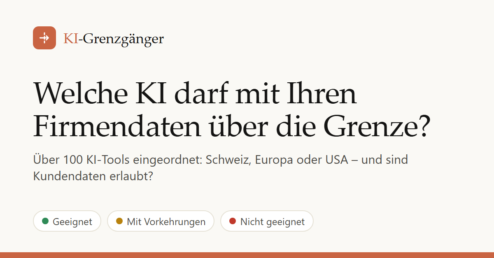

# KI-Grenzgänger

**Welche KI darf mit Ihren Firmendaten über die Grenze?**



Über 100 KI-Tools aus der Schweiz, Europa und den USA, eingeordnet nach zwei Fragen:
**Wo liegen die Daten?** und **Darf ich Kunden- oder Personendaten eingeben?**
Drei Fragen im Berater genügen, dann gibt es eine Empfehlung mit Begründung.

- Unabhängig: keine Werbung, keine Affiliate-Links, kein Tracking
- Ampeln für Personendaten und Berufsgeheimnis, mit Quellen in jedem Steckbrief
- Keine Rechtsberatung – massgeblich ist immer der Vertrag mit dem Anbieter

**Fehler gefunden?** → [Issue eröffnen](../../issues/new?template=fehler-melden.yml) (auch Anbieter sind willkommen).

**Lizenz:** Texte und Daten [CC BY 4.0](https://creativecommons.org/licenses/by/4.0/deed.de) (frei teilbar mit Quellenangabe
«KI-Grenzgänger»), Code MIT – siehe [LICENSE](LICENSE).

---

## Für Mitwirkende

Statische Website, gebaut aus `docs/` und veröffentlicht auf **GitHub Pages** – ohne Server, ohne Datenbank.

### Lokal ansehen (Windows)

```powershell
python -m venv .venv                        # nur beim ersten Mal
.venv\Scripts\python -m pip install -r requirements.txt
.venv\Scripts\python build.py --serve
```

Dann http://127.0.0.1:8000 öffnen. Änderungen in `docs/` oder `grenzgaenger/` werden automatisch neu gebaut
(Seite im Browser neu laden). Nur bauen: `.venv\Scripts\python build.py` → Ergebnis in `_site/`.

### Veröffentlichen

1. Code auf den Branch `main` pushen.
2. In GitHub: **Settings → Pages → Build and deployment → Source: «GitHub Actions»**.
3. Bei jedem Push baut `.github/workflows/pages.yml` die Seite (inkl. Datencheck) und veröffentlicht sie.
   Enthalten die Daten Fehler, bricht der Build ab und die alte Version bleibt online.

Der Workflow setzt zwei Adressen automatisch:
`GRENZGAENGER_SITE_URL` (öffentliche Adresse – nötig für die LinkedIn-Vorschau) und `GRENZGAENGER_REPO_URL` (für «Fehler melden»).
Bei eigener Domain `GRENZGAENGER_SITE_URL` im Workflow fest eintragen. Lokal sind beide leer; die Seite funktioniert trotzdem.

### Seiten

| Seite | Inhalt |
| --- | --- |
| `/` – **Berater** | Drei Fragen (Datenart, Datenort, Einsatzzweck) → bis zu drei Empfehlungen. Fallen Leistung und Datenschutz auseinander: «Beste Leistung», «Bester Datenschutz», «Guter Kompromiss». Erfüllt ein Tool beides: «Beste Wahl» + «Ebenfalls passend». Jede Kombination ist eine eigene Seite mit eigener Vorschau, z.B. `/berater/personendaten/europa/chat/`. |
| `/verzeichnis/` | Alle Tools mit Filtern und Sortierung. Filter stehen in der Adresse (`?sens=pd&ort=ch`). |
| `/tool/<id>/` | Steckbrief, mit Link «Fehler melden». Zusätzlich `steckbrief.html` als Fragment für die seitliche Schublade. |
| `/grundlagen/` | Faustregeln, Ampel-Erklärung, Glossar |
| `/marktanalyse/` | Die Marktanalyse aus `docs/Marktanalyse*.md` |
| `/ueber/` | Über das Projekt, Vollständigkeit der Daten, Fehler melden, Lizenz |

**Die Berater-Adressen nicht mehr umbenennen** (`PFAD_NAMEN` in `grenzgaenger/site.py`) – sie stehen in geteilten Links.

### Daten aktualisieren

Alle Inhalte kommen aus `docs/ki_tools_verzeichnis.json` und `docs/Marktanalyse*.md`.

- Mit Claude Code: Skill **`/ki-daten-aktualisieren`** (`.claude/skills/ki-daten-aktualisieren/SKILL.md`).
- Danach immer prüfen: `.venv\Scripts\python datencheck.py --fix`

### Marktanalyse schreiben

Normales Markdown (Tabellen erlaubt; `## Überschriften` bilden das Inhaltsverzeichnis). Zusätzlich:

- `[Infomaniak](tool:ch-infomaniak-ai-services)` verlinkt auf einen Steckbrief. Unbekannte IDs brechen den Build ab.
- `[Verzeichnis](seite:verzeichnis)`, `seite:grundlagen`, `seite:berater` verlinken auf Seiten der Website.
- Kennzahlen werden beim Bauen eingesetzt: `{{ anzahl }}`, `{{ anzahl_schweiz }}`, `{{ anzahl_europa }}`, `{{ anzahl_usa }}`,
  `{{ anzahl_andere }}`, `{{ anzahl_ch_moeglich }}`, `{{ anzahl_eu_moeglich }}`, `{{ anzahl_ch_oder_eu }}`, `{{ anzahl_vischer }}`,
  `{{ anzahl_pruefpunkte }}`, `{{ stand }}`.

### Struktur

```
docs/                     Daten (JSON) und Marktanalyse (Markdown)
build.py                  Baut die Website nach _site/ (--serve: lokale Vorschau)
datencheck.py             Validierung der Daten (--fix korrigiert Zähler)
grenzgaenger/data.py           Laden der JSON + Übersetzung in einfache Sprache (Ampeln, Kategorien, Empfehlungen)
grenzgaenger/site.py           Seiten erzeugen: Berater, Verzeichnis, Steckbriefe, Marktanalyse, Über
grenzgaenger/ui.py             Icons und kleine HTML-Bausteine
grenzgaenger/templates/        HTML (Jinja2)
grenzgaenger/static/           CSS, JS, Vorschaubild für LinkedIn (og-bild.png)
design/                   Entwürfe: Design-Vorschau und Vorlage des Vorschaubilds
.github/                  Veröffentlichung auf GitHub Pages, Formular «Fehler melden»
```

Vorschaubild ändern: `design/og-bild.html` anpassen, dann `.venv\Scripts\python design\build_og_bild.py` (braucht Edge oder Chrome).
